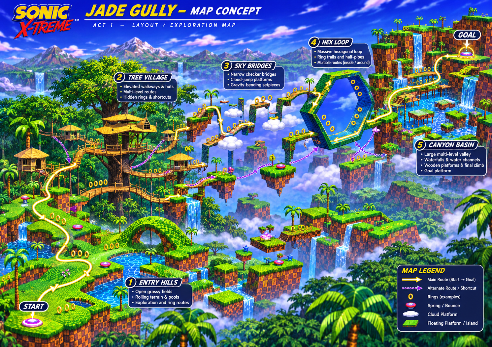

# Jade Gully — Act 1: concept map (visual target)

**Status:** fan-made **concept artwork**, not the recovered original level mesh, a build of the leaked game, or a playable stage. This document captures the approved artistic direction. Keep the original Saturn/718 references clearly separate from proposed expansions.

## Proposed layout

For the **editable five-region Blender generator**, see [Jade Gully 3D implementation](JADE_GULLY_3D_IMPLEMENTATION.md). The existing [Tree Village V3 kit](TREE_VILLAGE_BLENDER_ASSET_CHECKLIST.md) is a separately qualified small art-source cell. The present single-stage Saturn baker cannot carry the full map.

> **Correction (2026-11-22):** the list below does not match the painting. The image labels
> **1 ENTRY HILLS, 2 TREE VILLAGE, 3 SKY BRIDGES, 4 HEX LOOP, 5 CANYON BASIN**.
> The painting-faithful reconstruction is [concept v4](JADE_GULLY_CONCEPT_V4.md); the list
> below is kept only as the history of the v1–v3 blockout.

The v1–v3 blockout used these five regions, translated into +Y progression:

1. **Sonic's Base** — clearing, tutorial, access to optional routes and starter dome.
2. **Jade Ridges** — checkerboard cliffs, switchbacks, a large hexagonal corkscrew and a lower loop.
3. **Bamboo Heights** — multilevel tree village, bamboo platforms, hanging bridges and high shortcuts.
4. **Gully Current** — river gorge, waterfalls, gravity-wall references and lower exploration passages.
5. **Jade Summit / Exit** — final forest climb, paired loops, suspended spans and goal.

The Blender scene generator is an offline art blockout, with a five-sector topology, visual guide routes and recognizable landmarks. It does not yet implement the gameplay, gravity camera, collision or runtime sector streaming.

The intended gameplay is **exploration + speed + platforming**, with a readable main route, optional risk/reward shortcuts, increasing elevation, and room for the fisheye camera's gravity transitions. No fixed duration, world dimensions or measured speed are inferred from this painting. Segment lengths, collision geometry, LOD and target completion time must be specified and tested as game data.

## Historical grounding (not a claim of 1:1 replication)

- [Secrets of Sonic Team — Jade Gully Zone](https://sost.emulationzone.org/sonic_xtreme/jade_gully/index.htm): images from the TGS footage show checkerboard ledges, a hexagonal loop, narrow passages, changes of gravity and a fisheye view.
- [Secrets of Sonic Team — 718 tech demo](https://sost.emulationzone.org/sonic_xtreme_718/techdemo/index.htm): a **different early build**, with green hills, water, scattered rings and visible geometry pop-in.
- [The Models Resource — Jade Gully extracted model](https://models.spriters-resource.com/saturn/sonicxtreme/asset/467305/): 3D mesh and nine PNG textures; use as a technical reference only after actual inspection, not evidence that the concept map follows its shape.
- [Project SXU 2020 Jade Gully Act 1](https://www.moddb.com/games/sonic-x-treme-unity/downloads/project-sxu-2020-jade-gully-demo): a **separate unofficial Unity remake**, not proof of the Saturn layout.

## Asset and implementation status

The approved full-resolution concept PNG is published at **[`docs/concepts/jade-gully-act1-concept.png`](jade-gully-act1-concept.png)**. The PNG is *not source geometry* and is not an asset derived automatically from Sega's extracted mesh. The authored 3D scene is generated from [`assets/levels/jade_gully_concept_v1.json`](../../assets/levels/jade_gully_concept_v1.json) with [`tools/create_jade_gully_concept.py`](../../tools/create_jade_gully_concept.py). No image-to-collision conversion is implied.

Do **not** merge the experimental [Jade Gully PR #2](https://github.com/celsowm/sonic-xtreme-saturn/pull/2) as part of concept-art publication: performance and visual acceptance gates remain open. The `main` baseline and build reproducibility should be preserved.
